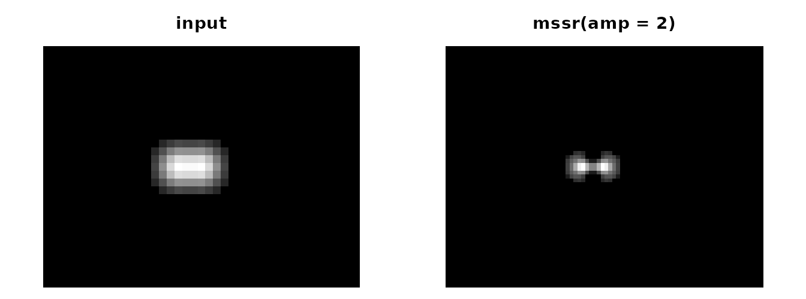
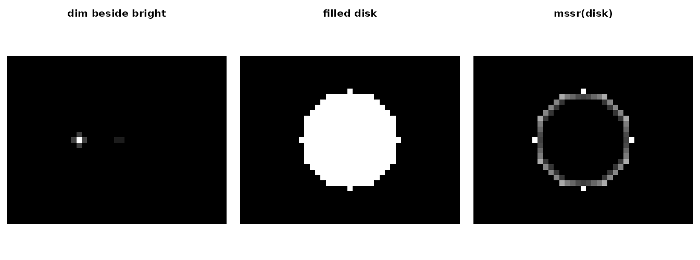

# Single-frame MSSR with mssrscopR

All images here are synthetic and generated in this document, so the
true scene is known.

## The operator

Mean-Shift Super-Resolution (MSSR; Torres-García et al. 2022,
<doi:10.1038/s41467-022-34693-9>) subtracts a local, range-weighted
mean-shift estimate from each pixel and refines the result over `order`
steps. `fwhm` is the point-spread-function width in **input pixels** and
has no default.

``` r

g <- expand.grid(r = 1:31, c = 1:41)
spot <- function(r0, c0, a = 1) a * exp(-((g$r - r0)^2 + (g$c - c0)^2) / (2 * (3 / 2.3548)^2))
pair <- function(sep) matrix(spot(16, 18) + spot(16, 18 + sep) + 0.05, 31, 41)
x <- pair(3)                       # two sources 3 px apart, FWHM 3 px
res <- mssr(x, fwhm = 3, amp = 2)
res
#> <mssr_result> intensity_weighted_structure
#>   input 31 x 41 -> output 62 x 82 (amp 2, extent grid)
#>   fwhm 3 px, order 1, kernel disk (half-size 3), mesh TRUE
#>   engine mssr_r_rev2; zero fraction 0.488
#>   Not a quantitative intensity: measure on the original data.
op <- par(mfrow = c(1, 2), mar = c(0.5, 0.5, 2, 0.5))
show(x, "input"); show(as.matrix(res), "mssr(amp = 2)")
```



``` r

par(op)
```

The amplified grid only adds samples.
[`mssr_coords()`](https://cttir.github.io/mssrscopR/reference/mssr_coords.md)
places them in input-pixel units, and the field of view stays
`[0.5, n + 0.5]`:

``` r

range(mssr_coords(res)$col)
#> [1]  0.75 41.25
res$transform$spacing
#> row col 
#> 0.5 0.5
```

How far does the separation go? Compare the value at the midpoint
between the two sources with the value at a source center, in the input
and in the MSSR map (values below 1 mean a dip between the sources):

``` r

mid_ratio <- function(sep) {
  x <- pair(sep)
  r <- mssr(x, fwhm = 3, amp = 2)
  v <- as.matrix(r)
  co <- mssr_coords(r)
  row <- which.min(abs(co$row - 16))
  at_input <- function(cc) stats::approx(1:41, x[16, ], cc)$y
  at_mssr <- function(cc) stats::approx(co$col, v[row, ], cc)$y
  c(input = at_input(18 + sep / 2) / at_input(18), mssr = at_mssr(18 + sep / 2) / at_mssr(18))
}
round(rbind(`2.4 px` = mid_ratio(2.4), `3 px` = mid_ratio(3)), 3)
#>        input  mssr
#> 2.4 px 1.086 1.235
#> 3 px   0.968 0.255
```

At 3 px the input shows only a shallow dip, which MSSR deepens strongly.
At 2.4 px the blurred sources form a single hump, and MSSR returns a
single, sharper hump: it enhances existing structure but does not split
sources that the blur has already merged.

## Known failure modes

MSSR is nonlinear. A dim structure next to a bright one is strongly
suppressed, and broad filled objects can be hollowed or fragmented:

``` r

y <- matrix(spot(16, 14) + spot(16, 21.5, 0.1) + 0.02, 31, 41)   # 10:1 brightness
disk <- outer(1:31, 1:41, function(r, c) as.numeric((r - 16)^2 + (c - 21)^2 <= 81))
disk <- disk + 0.02
ry <- as.matrix(mssr(y, fwhm = 3))
rd <- as.matrix(mssr(disk, fwhm = 3))
c(input_ratio = y[16, 22] / y[16, 14], mssr_ratio = ry[16, 22] / ry[16, 14])
#> input_ratio  mssr_ratio 
#> 0.110379995 0.008616307
op <- par(mfrow = c(1, 3), mar = c(0.5, 0.5, 2, 0.5))
show(ry, "dim beside bright"); show(disk, "filled disk"); show(rd, "mssr(disk)")
```



``` r

par(op)
```

The outputs are therefore **not quantitative**;
`res$diagnostics$quantitative` is always `FALSE`.

## Masks with measurements on the original data

A structure map can select pixels, but measurements belong to the
original image.
[`mssr_mask()`](https://cttir.github.io/mssrscopR/reference/mssr_mask.md)
keeps an exact number of pixels of a region. `tie_fraction` reports the
share of the selected pixels that random tie-breaking decided. That
share can be large, because the mean shift is clipped at zero and many
pixels tie there.

``` r

m <- mssr_mask(mssr(x, fwhm = 3), fraction = 0.2)
c(coverage = attr(m, "coverage"), tie_fraction = attr(m, "tie_fraction"))
#>     coverage tie_fraction 
#>    0.2006294    0.8784314
c(mean_all = mean(x), mean_masked = mean(x[m]))
#>    mean_all mean_masked 
#>  0.06604718  0.11992835
```

Selecting pixels this way changes the measured population. It is not
known to improve any downstream analysis, so evaluate it for your own
task.

## Degenerate input and unsupported requests

Flat frames return zeros flagged as degenerate. Requests the package
cannot honor fail with classed errors:

``` r

mssr(matrix(1, 5, 5), fwhm = 3)$diagnostics[c("degenerate", "degenerate_reason")]
#> $degenerate
#> [1] TRUE
#> 
#> $degenerate_reason
#> [1] "flat input"
try(mssr(array(0, c(4, 4, 3)), fwhm = 3))     # no axis is guessed
#> Error in mssr(array(0, c(4, 4, 3)), fwhm = 3) : 
#>   `x` has 3 dimensions; process one 2D frame at a time (no axis is
#> inferred).
try(mssr(matrix(c(1, NA, 3, 4), 2), fwhm = 3)) # non-finite input
#> Error in mssr(matrix(c(1, NA, 3, 4), 2), fwhm = 3) : 
#>   `x` contains NA, NaN or infinite values; MSSR is undefined for them.
```

## Interactive exploration

[`mssr_app()`](https://cttir.github.io/mssrscopR/reference/mssr_app.md)
opens the same computations in a Shiny app (it needs the shiny, bslib
and jsonlite packages). It shows the input and the structure map on the
same input-pixel axes, line profiles, masks measured on the input and
the self-test, and offers the results for download. The examples above
are available there, and frames can be uploaded as text tables, PNG or
TIFF.

``` r

mssr_app()
```

## Checking an installation

[`mssr_selftest()`](https://cttir.github.io/mssrscopR/reference/mssr_selftest.md)
recomputes the bundled synthetic fixtures. They were produced by the
package’s engine definition, so this is a regression check of the
installation, not an independent validation:

``` r

st <- mssr_selftest()
st[, c("fixture_id", "max_abs_error", "passed")]
#>                           fixture_id max_abs_error passed
#> 1                       fx01_amp1_o1  0.000000e+00   TRUE
#> 2                fx02_amp1_o1_nonorm  0.000000e+00   TRUE
#> 3                  fx02_amp1_o1_norm  0.000000e+00   TRUE
#> 4                   fx03_constant_o2  0.000000e+00   TRUE
#> 5                       fx04_zero_o1  0.000000e+00   TRUE
#> 6                       fx05_amp1_o0  0.000000e+00   TRUE
#> 7                       fx05_amp1_o1  0.000000e+00   TRUE
#> 8                fx06_amp2_extent_o1  9.436896e-15   TRUE
#> 9              fx06_amp2_endpoint_o1  6.883383e-15   TRUE
#> 10               fx07_amp1_o3_nonorm  0.000000e+00   TRUE
#> 11 fx08_amp2_extent_o1_halfup_nomesh  0.000000e+00   TRUE
#> 12      fx09_amp3_endpoint_o2_nonorm  0.000000e+00   TRUE
#> 13               fx10_amp2_square_o1  0.000000e+00   TRUE
#> 14        fx11_amp1_square_o2_nonorm  0.000000e+00   TRUE
```
